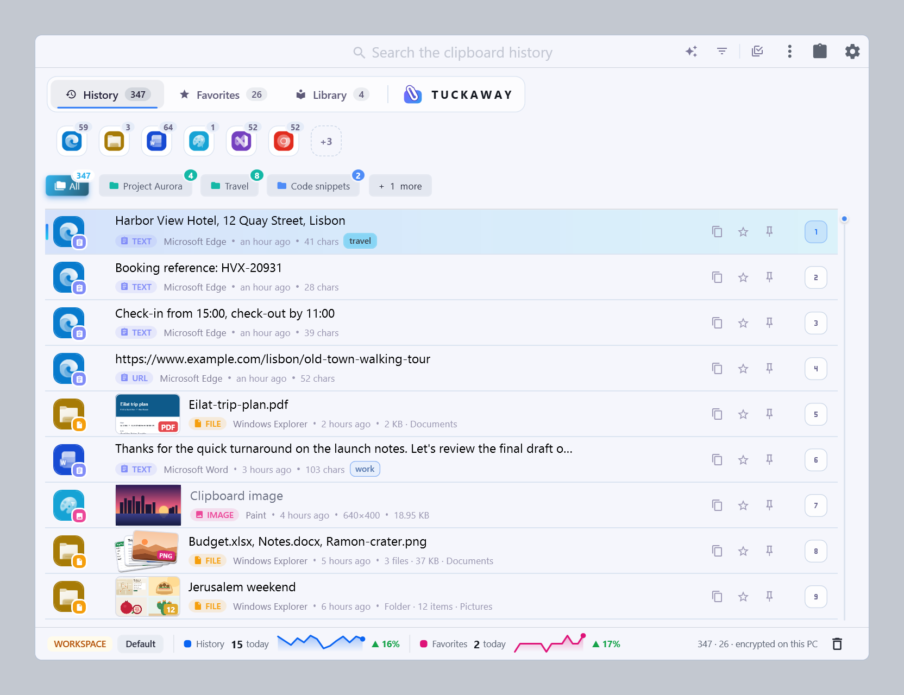

# Tuckaway Releases

Releases of [Tuckaway](https://raviv-steinberg.github.io/Tuckaway-Releases/), a clipboard manager for Windows. It keeps
everything you copy in a searchable history on your PC, encrypted, so you can find it and paste it again with one
shortcut.

<picture>
  <source media="(prefers-color-scheme: dark)" srcset="docs/images/screens/full/history-dark.png">
  <source media="(prefers-color-scheme: light)" srcset="docs/images/screens/full/history-light.png">
  
</picture>

[Website](https://raviv-steinberg.github.io/Tuckaway-Releases/) ·
[Screenshots](https://raviv-steinberg.github.io/Tuckaway-Releases/screenshots.html) ·
[Privacy policy](https://raviv-steinberg.github.io/Tuckaway-Releases/privacy.html)

## Install

Download `TuckawaySetup-<version>.exe` from the [latest release](https://github.com/raviv-steinberg/Tuckaway-Releases/releases/latest)
and run it. It installs for your user only (no administrator rights needed) and keeps itself up to date.

Tuckaway is also in the Microsoft Store (product ID 9PMNH9TSMWC8); the Store keeps that copy up to date.

## How updates work

Each release holds the setup and a small `version.json` (the version, the setup's address and its SHA-256, and what
changed). The direct download reads `version.json` from the latest release, and when it finds a newer version it
downloads the setup from this repository and checks its SHA-256 before it runs. The check sends nothing about you or
your clips.

This repository holds app releases only: its latest release is always the newest Tuckaway. Model files are in
[Tuckaway-Models](https://github.com/raviv-steinberg/Tuckaway-Models). The website's pages are in the `docs` folder.
